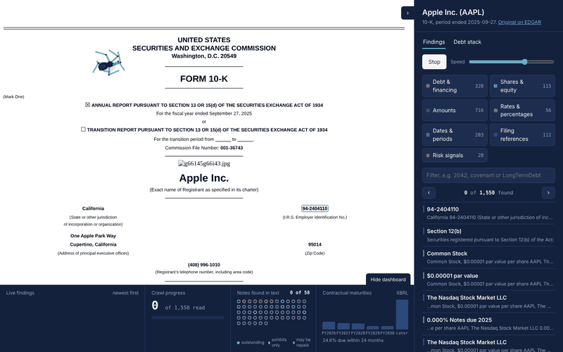

# DebtScope

**Corporate debt structure and maturity-wall extraction from SEC EDGAR filings.**

Give it a ticker. DebtScope downloads the latest 10-K (or 10-Q / 20-F) and the
company's XBRL facts from the SEC, finds every bond the filing mentions, ties the
bond list back to the audited debt totals, and writes a formula-driven Excel
credit pack: summary metrics, maturity wall chart, bond table and a line-by-line
audit trail.

```
python -m debtscope AAPL MSFT ORCL
```



## In plain English

Every US-listed company files an annual report (the 10-K) with the SEC. Buried in
it is how much the company has borrowed, from whom, at what interest rate, and
when each loan has to be paid back. That information is scattered over hundreds
of pages and written differently by every company.

DebtScope does the reading for you:

1. **You type a ticker** (for example `AAPL`).
2. **It downloads the official filing** and the company's tagged financial data
   straight from the SEC.
3. **It finds every bond and loan** mentioned in the document: interest rate,
   maturity, amount, currency.
4. **It checks its own work**: the bonds it found must add up to the debt total
   the company reports. If they don't, it says so instead of guessing.
5. **It gives you two outputs**:
   - an **Excel report** with the debt table, a chart of when the debt comes due
     (the "maturity wall"), key credit ratios, and the exact sentence each number
     was taken from;
   - a **visual crawler**: the original filing in your browser with every
     finding highlighted, and an animated spider that walks through the document
     linking each piece of data, while a live dashboard fills up below.

## Results on real filings

| Issuer | Filing | Debt explained bond by bond | Notes |
|---|---|---|---|
| Apple | 10-K, FY ended 27 Sep 2025 | **USD 91,281m of 91,281m (100%)** | Debt reported in aggregated rows; 98 individual notes linked from the cover page and exhibit index |
| Microsoft | 10-K, FY ended 30 Jun 2026 | **USD 46,136m of 46,136m (100%)** | Debt table grouped by issuance year with ranges split across cells; EUR issuance detected |

Reconciliation is against the contractual maturity schedule tagged in XBRL
(face value), so the check is principal against principal.

## Quick start (Windows, no terminal)

1. Install Python from python.org (tick *Add python.exe to PATH*).
2. Download this repository (*Code* -> *Download ZIP*) and extract it.
3. Double-click `DebtScope.bat`. The first run installs the libraries and puts a
   DebtScope icon on your Desktop.
4. Type a ticker, your name and email (the SEC requires them), press *Analyze*.

---

## Why

The debt footnote is where refinancing risk lives, but it is spread across the
cover page, footnote tables and MD&A prose, in mixed currencies and scales.
Credit, DCM and structuring desks rebuild the same table by hand for every
issuer. DebtScope automates the first pass and, more importantly, **tells you how
much of the reported debt it could actually explain**.

## Pipeline

```
 EDGAR ─┬─ filing HTML ──► 1. Cover page (Section 12(b) listed notes)
        │                  2. Footnote tables (principal, scale, nil rows)      ──► merge on
        │                  3. Narrative ("issued $1.5bn of 4.000% Notes due 2028")    coupon + maturity
        │                                                                          │
        └─ XBRL facts ───► totals, maturity schedule, EBIT, interest ─────────────► reconcile
                                                                                   │
                                                              metrics + warnings ◄─┘
                                                                     │
                                                            Excel credit pack
```

| Module | Responsibility |
|---|---|
| `edgar.py` | SEC client: ticker→CIK, filings index, documents, companyfacts. Enforces SEC fair-access rules (declared User-Agent, ≤10 req/s), retries 429/5xx with backoff, disk cache. |
| `extract.py` | Three independent extraction passes with an evidence trail; merge with conflict flags. |
| `xbrl.py` | Picks the facts reported *in this filing for this period* (filters out comparatives and quarterly durations). |
| `analytics.py` | Reconciliation, double-count control, credit metrics, data-quality warnings. |
| `excel.py` | Live-formula workbook, maturity wall chart, comparison sheet. |
| `viewer.py` | Visual crawler: annotates the filing, links bond mentions to the debt stack, injects the UI. |
| `web/` | Presentation layer only (no data logic): `spider.js` (walking spider), `dashboard.js` (live strip), `crawler.js` (panel, crawl, tracing), `crawler.css`, `panel.html`. |
| `gui.py` | Desktop window (double-click `DebtScope.bat`). |
| `cli.py` | Command line interface. |

## Methodology

**Merge key.** Each instrument is identified by (coupon, fixed/floating,
maturity year). Evidence from all three passes is attached to it.

**Principal.** Taken from the footnote table when available (most reliable), else
from narrative text. Only amounts in the reporting currency are used; an amount
quoted at issuance in another currency (e.g. €800m) is kept as evidence and
flagged, never mixed into USD totals.

**Nil rows.** A dash in the current-period column means the note is no longer
outstanding; the instrument is marked `redeemed`.

**Table layouts.** Three layouts are recognised: one row per note ("3.600% Notes
due 2042 | 1,250"), aggregated rows ("Fixed-rate 0.000%–4.850% notes | 2026–2062"),
and column layouts by issuance ("2016 issuance | 2026–2056 | 2.40%–3.95% |
2.46%–4.03% | 6,000"). Rows of the exhibit index (indentures, officer's
certificates) are kept as a separate source: they prove a note was issued but
carry no balance, and their exhibit numbers are never read as amounts.

**Aggregated rows.** Some issuers (Apple, for example) report a single row such
as *Fixed-rate 0.000%–4.850% notes, 2026–2062*. Individual notes that fall
inside such a row are excluded from totals to avoid double counting.

**Reconciliation.** `coverage = extracted principal / XBRL LongTermDebt`. Below
60% or above 115% a warning is raised with the likely cause.

**Metrics.**

| Metric | Definition |
|---|---|
| Gross debt | Term debt (carrying) + commercial paper |
| Net debt | Gross debt − cash − current marketable securities |
| Net debt / EBITDA | EBITDA = operating income + D&A (unadjusted) |
| Interest coverage | Operating income / interest expense |
| Implied cost of debt | Interest expense / period-end gross debt |
| Weighted avg coupon | Principal-weighted, fixed-rate outstanding notes |
| Weighted avg maturity | Principal-weighted years from period end |
| Due within 24 months | XBRL schedule years 1–2 / total scheduled principal |

## Output

`reports/DebtScope_<TICKER>_<FORM>_<PERIOD>.xlsx`

| Tab | Content |
|---|---|
| Summary | Filing details and all metrics as live formulas |
| Maturity Wall | Bond-level vs XBRL schedule by year, cumulative %, chart |
| Instruments | One row per bond: coupon, maturity, years to maturity, principal, status, sources, flags |
| XBRL | Every fact used, with tag, period and accession |
| Audit Trail | The exact text each number was extracted from |

Blue font = extracted data, black = formula. Change the period-end date or a
principal and everything recalculates.

With several tickers a `DebtScope_comparison.xlsx` is added.

`reports/DebtScope_<TICKER>_<FORM>_<PERIOD>_crawler.html` - the **visual crawler**:
the original filing with every finding highlighted in seven categories (debt &
financing, shares & equity, amounts, rates, dates, filing references, risk
signals). Every inline-XBRL number is highlighted too, with its concept
(e.g. `us-gaap:LongTermDebt`) on hover. *Start crawl* sends a procedurally
animated spider through the document: eight legs solved with inverse
kinematics, an alternating gait, feet that grip the highlighted words, and a
silk thread to each finding. A dashboard strip follows the crawl live:
findings feed, progress by category, the notes found in the text, and the
XBRL maturity schedule. In the *Debt stack* tab, selecting a note sends the
spider to trace every place it is mentioned in the filing.

## Install (Windows, macOS, Linux)

Requires Python 3.10+.

```
pip install -r requirements.txt
```

The SEC requires you to identify yourself. Set it once:

```
# Windows (PowerShell)
setx DEBTSCOPE_IDENTITY "Your Name your.email@example.com"
# macOS / Linux
export DEBTSCOPE_IDENTITY="Your Name your.email@example.com"
```

or pass `--identity "Your Name your.email@example.com"` on each run.

## Usage

**Windows, no terminal:** double-click `DebtScope.bat`. The first time it installs
the libraries and puts a *DebtScope* icon on the Desktop; then a window opens
where you type tickers and press *Analyze*. The Excel report opens by itself
(saved in `Documents/DebtScope reports`).

**Command line:**

```
python -m debtscope AAPL                       # latest 10-K
python -m debtscope AAPL MSFT ORCL --out reports
python -m debtscope NVDA --form 10-Q           # latest quarterly
python -m debtscope AAPL --json                # also dump the raw profile
python -m debtscope --offline filing.htm facts.json --period 2025-09-27   # local files
```

## Tests

```
python -m unittest discover -s tests -v
```

The fixtures in `tests/fixtures` are **synthetic** (an invented issuer) so the
tests run offline and deterministically; they cover cover-page parsing,
scale detection, nil rows, aggregated rows, multi-note sentences,
foreign-currency issuance, hidden inline-XBRL, SEC client retries and caching.

## Known limitations

- **US-registered issuers only** (EDGAR). European issuers file ESEF reports elsewhere.
- Many 10-Ks aggregate notes or list them only in exhibits (indentures,
  prospectus supplements). Coverage will then be low, and the tool says so.
- Bond **denomination** is inferred from nearby text. `USD*` means assumed.
- Table parsing assumes the current period is the first numeric column, the
  standard SEC layout; the assumption is recorded in the Audit Trail.
- Calendar vs fiscal year: the XBRL schedule is by fiscal year after period
  end; bond-level maturities are by calendar year.
- Not a substitute for reading the filing. Not investment advice.

## Roadmap

1. ~~EDGAR client, extraction, reconciliation, Excel credit pack~~
2. ~~Visual crawler: highlighted filing, walking spider, live dashboard, bond tracing~~
3. **Debt events monitor (8-K)**: scan the last 12 months of 8-Ks for Items 2.03
   (new financial obligations), 1.01 (material agreements) and 4.02 (non-reliance on
   prior financials); pull exact amount, coupon and maturity of new bonds from the
   424B2 prospectus supplements and update the debt stack bond by bond
4. **LTM metrics for 10-Q**: last-twelve-months EBITDA and interest
   (FY + current YTD − prior YTD), so leverage and coverage work on quarterly filings
5. **IFRS taxonomy for 20-F filers**: map `ifrs-full` XBRL concepts so European
   issuers listed in the US get totals, ratios and maturity schedules
6. Peer comparison: maturity walls of several issuers on one chart

## License

MIT
